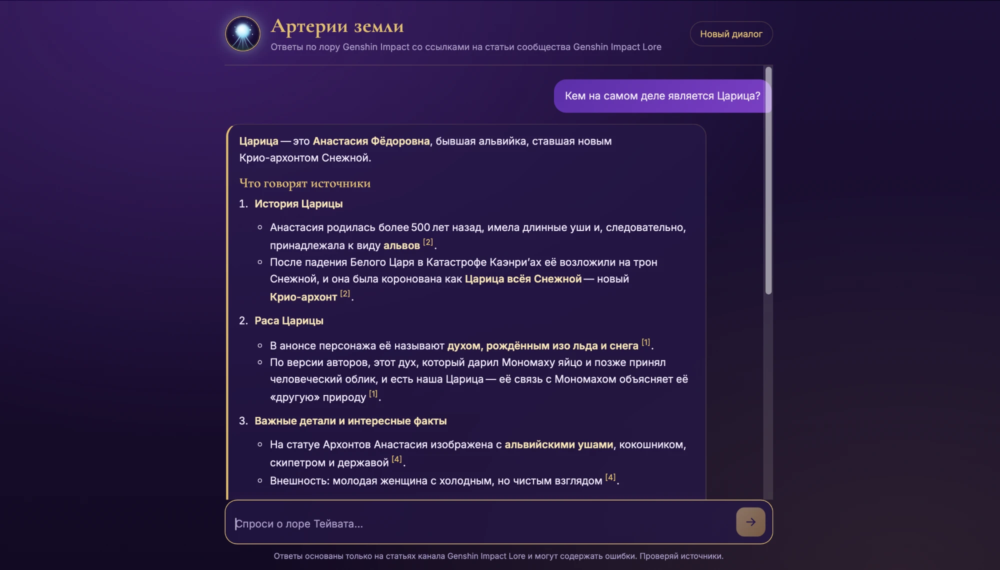

# ✦ Артерии земли

**Чат-бот по лору Genshin Impact, который не выдумывает.** Отвечает только по статьям русскоязычного сообщества
[Genshin Impact Lore](https://t.me/genshin_lore) и к каждому утверждению ставит ссылку на пост или статью.

Обычные LLM плохо знают лор Genshin и уверенно сочиняют. Здесь модель сначала ищет нужные фрагменты в базе
из ~1000 постов и ~60 статей канала, а отвечает только по ним (RAG — Retrieval-Augmented Generation).
Если ответа в статьях нет, бот так и говорит.

Два интерфейса: **сайт** с чатом и **Telegram-бот**.



**Стек:** Python 3.12 · LangChain · LangGraph · Qdrant (гибридный поиск) · FastAPI · React + Vite + TypeScript ·
python-telegram-bot · Groq (gpt-oss) · Docker Compose · uv

---

## Как это работает

```
 Сайт (React) ──┐                ┌──────────────── RAG-сервис (FastAPI) ────────────────┐
                ├── HTTP API ───►│ LangGraph:                                           │
 Telegram-бот ──┘                │   rewrite → retrieve → grade ─┬→ cite → answer       │
                                 │                ▲              │                      │
                                 │                └─ reformulate ┘ (если не нашлось)    │
                                 │ модель эмбеддингов · LLM · история диалогов          │
                                 └───────────────────────┬──────────────────────────────┘
                                                         ▼
                                     Qdrant: смысловой поиск + BM25 → слияние RRF
```

**Подготовка базы (один раз):**
1. **Сбор** — посты канала через публичную страницу `t.me/s/genshin_lore` (без ключей и авторизации) и статьи
   с Teletype по ссылкам из постов. Реклама и короткие анонсы отсеиваются.
2. **Нарезка** — по структуре: абзацы одного раздела склеиваются в фрагменты до 1200 символов, к каждому
   добавляется «Название статьи — Раздел».
3. **Индексация** — у каждого фрагмента два вектора: смысловой (модель `multilingual-e5-large`) и BM25
   (точные слова, со стеммингом для русского). Хранятся в Qdrant.

**Ответ на вопрос** (граф LangGraph):

| Шаг | Что происходит | Модель |
|---|---|---|
| `rewrite` | Уточняющий вопрос («а кто она?») переписывается в полный с учётом истории. На первом вопросе пропускается | gpt-oss-20b |
| `retrieve` | Гибридный поиск: смысловой + по словам, объединение через RRF | — |
| `grade` | Проверка: есть ли в найденном ответ на вопрос | gpt-oss-20b |
| `reformulate` | Если нет — другой поисковый запрос (имена, синонимы) и повторный поиск | gpt-oss-20b |
| `cite` | Нумерация источников для ссылок [1], [2] | — |
| `answer` | Ответ строго по найденному, со ссылками, канон отдельно от теорий авторов | gpt-oss-120b |

Поэтому обычный вопрос — это **2 запроса к Groq**: один к `gpt-oss-20b` (проверка) и один к `gpt-oss-120b`
(ответ). Уточняющий вопрос — 3, неудачный поиск — до 5. У моделей раздельные лимиты, так что служебные шаги
не съедают лимит ответов. Отключить проверку: `GRADE_DOCUMENTS=false` в `.env`.

История диалогов хранится в RAG-сервисе по `thread_id` (`tg:<id чата>`, `web:<id сессии>`), поэтому бот и сайт
— тонкие клиенты: присылают вопрос и получают ответ.

---

## Запуск

Нужны [uv](https://docs.astral.sh/uv/) и Node.js ≥ 22.12 (для сайта). Все команды — из корня репозитория.

### 1. Установка

```bash
uv sync --all-packages                 # Python-зависимости (RAG-сервис + бот)
cd frontend && npm install && cd ..    # зависимости сайта
cp .env.example .env                   # и вписать ключи
```

В `.env` нужны минимум **`GROQ_API_KEY`** ([console.groq.com/keys](https://console.groq.com/keys), бесплатно)
и для бота — **`TELEGRAM_BOT_TOKEN`** (у [@BotFather](https://t.me/BotFather)).

### 2. База знаний

```bash
uv run genshin scrape     # собрать посты и статьи → data/raw/        (~5–10 мин)
uv run genshin index      # нарезать и проиндексировать → data/qdrant/ (первый раз ~2,2 ГБ модели + 20–40 мин)
```

Обе команды инкрементальные: повторный запуск докачивает и индексирует только новое.

### 3. Проверка из терминала

```bash
uv run genshin search "Шиукоатль"                      # что находит поиск (без LLM)
uv run genshin ask "Кто такие шесть героев Каэнри'ах?"  # весь граф: шаги, ответ, источники
```

### 4. Сервис, бот и сайт — каждый в своей вкладке терминала

```bash
uv run genshin serve              # RAG-сервис → http://127.0.0.1:8000/docs
uv run genshin-bot                # Telegram-бот (нужен работающий сервис)
cd frontend && npm run dev        # сайт → http://localhost:5173
```

### Docker (всё сразу)

```bash
docker compose up -d qdrant
docker compose run --rm rag genshin index     # один раз
docker compose up -d                          # сервис :8000, сайт :8080, бот
```

---

## Оценка качества

```bash
uv run genshin eval generate -n 40   # LLM составляет вопросы по случайным постам → data/eval/questions.jsonl
uv run genshin eval retrieval        # Hit@k и MRR: смысловой vs BM25 vs гибридный поиск (без LLM)
uv run genshin eval answers          # faithfulness (LLM-судья), доля ответов со ссылками, честные отказы
```

Сгенерированные вопросы стоит просмотреть руками и убрать неудачные.

---

## Настройки

| Где | Что |
|---|---|
| `.env` | Ключи API, токен бота, `QDRANT_URL`, эмбеддинги (`EMBEDDING_PROVIDER=local\|api`), любые настройки из `Settings` |
| [`config.py`](services/rag/src/genshin_rag/config.py) | Список LLM-провайдеров `PROVIDERS` (порядок = фолбэки) и значения по умолчанию |
| `frontend/.env` | `VITE_API_URL` — если сайт и API на разных доменах |

Все LLM-провайдеры OpenAI-совместимые, поэтому в коде один класс `ChatOpenAI`: чтобы сменить провайдера,
достаточно поменять `base_url`, модель и ключ. Сейчас: Groq → Mistral → Gemini → OpenRouter (используются те,
чей ключ есть в `.env`).

---

## Структура

```
.env.example            шаблон настроек
docker-compose.yml      qdrant + rag + bot + web
pyproject.toml, uv.lock Python-workspace и точные версии пакетов
docs/                   скриншот для README
data/                   pdf/ — исходные PDF; raw/, qdrant/, models/ — создаются командами (не в git)

services/rag/src/genshin_rag/      RAG-сервис
  ingest/         сбор: telegram.py (посты), articles.py (Teletype/Telegraph), pdf.py
  schema.py       единый формат документа
  chunking.py     нарезка на фрагменты
  embeddings.py   смысловые векторы (e5) и BM25
  store.py        Qdrant: запись и гибридный поиск
  llm.py          подключение LLM с фолбэками
  prompts.py      промпты
  graph.py        пайплайн на LangGraph
  api.py          HTTP API: /api/chat (стриминг), /api/ask, /api/threads/{id}
  evaluation.py   метрики качества
  config.py       настройки и провайдеры
  cli.py          команды `genshin …`

services/bot/src/genshin_bot/      Telegram-бот (клиент RAG-сервиса)
frontend/src/                      сайт: App.tsx, components/, useChat.ts, api.ts, styles.css
```

---

## Если что-то не работает

| Симптом | Причина и решение |
|---|---|
| `Storage folder data/qdrant is already accessed by another instance` | Локальный Qdrant открывает только один процесс. Останови `serve` перед `index` — или запусти Qdrant-сервер: `docker compose up -d qdrant` и `QDRANT_URL=http://localhost:6333` в `.env` |
| Бот: `NetworkError: httpx.ConnectError` | Нет связи с api.telegram.org. Бот сам повторяет отправку; если Telegram у тебя работает только через VPN/прокси — укажи `TELEGRAM_PROXY=socks5://127.0.0.1:<порт>` в `.env` |
| `429` / `rate limit` от Groq | Бесплатный лимит — 8K токенов в минуту (~1 вопрос в минуту). Подожди минуту или добавь ключ другого провайдера как запасной |
| Сайт не запускается, ошибка про `styleText` | Старый Node.js. Нужен ≥ 22.12: `node -v` |

---

## Источники и авторство

Все тексты принадлежат авторам канала [Genshin Impact Lore](https://t.me/genshin_lore). Собранный корпус не хранится
в репозитории (`data/raw` в `.gitignore`), а каждый ответ ссылается на оригинальный пост или статью.
